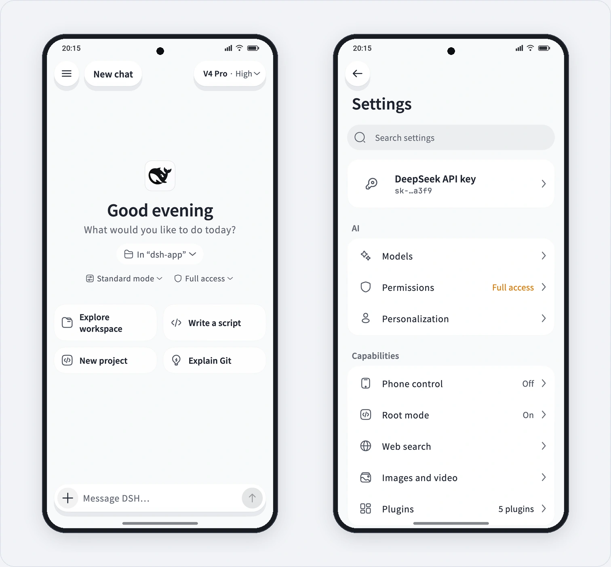

<p align="center">
  <a href="README.md">简体中文</a> · <b>English</b>
</p>

<p align="center">
  <picture>
    <source media="(prefers-color-scheme: dark)" srcset="docs/assets/hero-en-dark.webp">
    
  </picture>
</p>

<p align="center">
  An Android client for DeepSeek Harness with an integrated on-device runtime and remote host connectivity.
</p>

<p align="center">
  <a href="https://github.com/oaeen/dsh-go/releases/latest"></a>
  <a href="LICENSE"></a>
</p>

## Overview

Forked from [ccch1mneyyy/dsh-Go](https://github.com/ccch1mneyyy/dsh-Go), **dsh-go** is a mobile client for [DeepSeek Harness](https://github.com/deepseek-ai/deepseek-harness) combining a native Flutter UI with an embedded Linux runtime:

- **On-device runtime:** Install Ubuntu, Node.js, and DSH directly inside the app via PRoot without Root or Termux.
- **Remote connections:** Connect to DSH on computers or servers over SSH tunnels or [DSHarness Remote](https://github.com/liguobao/ds-harness-remote) (WebRTC / relay).
- **Native chat & tool workflows:** Switch models and thinking depth, steer or queue messages mid-turn, send images and files, use voice input, handle tool approvals, and toggle the web UI.
- **Phone control & local CLI:** Automate screen reading and gestures via Accessibility services, with explicit local Root mode and Android CLI support.
- **Plugin system:** Native tool cards, settings forms, scheduled tasks, and mobile adaptation for the official `ds-bot` plugin.

## What We Changed in This Fork

This fork is maintained for **personal daily use**, focusing on visual simplicity, de-cluttering, and third-party subscription integration:

1. **Clean, Minimalist UI Refinement**
   - Redesigned the light theme with a clean near-white backdrop (`#F8F9FA`) and pure white cards (`#FFFFFF`).
   - Replaced the app launcher icons and brand mark with the official DeepSeek Harness whale logo.
   - Removed colored background discs from icons across Settings, overview cards, and home suggestion cards; removed status dots and capsule backgrounds; hid redundant idle local-host subtitles in the header and drawer.
2. **Removed Unnecessary Features**
   - Stripped out desktop/in-app pet UI (Deepy / Whale girl), rotating home-screen tips, and promotional clutter to keep the workspace focused.
3. **Third-Party Subscription Support via Magpie**
   - Integrated the [Magpie](https://github.com/Bool-io/magpie) subscription plugin market and runtime compatibility layer, including OAuth / Device Code / Web session authentication, credential ref registration, and `FRAME_OVERHEAD` stream framing fixes.
   - Added support for third-party subscription providers including Claude Subscription, OpenAI Codex, Gemini CLI, Qwen Code, and GitHub Copilot.
4. **Mobile Control & Plugin Enhancements**
   - Added an explicit Root mode settings screen, local `su` CLI, loopback `adbd` bootstrap, and mobile client adaptation for the official `ds-bot` plugin.

## Build from Source

Building requires JDK 17, Flutter `3.47.x`, Android SDK/NDK, Python 3, and Node.js:

```bash
git clone https://github.com/oaeen/dsh-go.git
cd dsh-go

# Set up toolchain and runtime bundle
bash tooling/setup-toolchain.sh
source tooling/env.sh
bash runtime/build-runtime.sh arm64-v8a

# Build arm64 release APK
DSH_BETA_TOKEN_FILE= bash tooling/build-apk.sh -f arm64 --keep-daemon
```

The output APK is written to `app/build/app/outputs/flutter-apk/app-arm64-release.apk`. See [CONTRIBUTING.en.md](CONTRIBUTING.en.md) for verification commands.

## Repository Layout

| Path | Description |
| --- | --- |
| `app/` | Flutter native UI, state management, and Android Kotlin platform implementation |
| `packages/dsh_client/` | Pure Dart client for the DSH Web API (HTTP/SSE, mux, and session APIs) |
| `packages/dsh_remote/` | Dart client for DSH Remote transport (WebRTC / LAN / TURN / relay) |
| `runtime/` | PRoot Linux runtime packaging, DSH engine patches (`runtime/patches/`), and HTTP bridge |
| `sdk/plugin-kit/` | Plugin authoring kit |
| `docs/` | Architecture notes, user guides, and maintenance contracts |
| `tooling/` | Toolchain setup and APK build scripts |

## Acknowledgments & License

- Special thanks to the original author **[ccch1mneyyy](https://github.com/ccch1mneyyy)** for creating and open-sourcing [dsh-Go](https://github.com/ccch1mneyyy/dsh-Go).
- Thanks to [DeepSeek Harness](https://github.com/deepseek-ai/deepseek-harness), [Magpie](https://github.com/Bool-io/magpie), and [ds-harness-remote](https://github.com/liguobao/ds-harness-remote) by Li Guobao (`liguobao`).

This project is licensed under [AGPL-3.0](LICENSE); `sdk/` and `examples/` are licensed under MIT. See [THIRD_PARTY_NOTICES.md](THIRD_PARTY_NOTICES.md) for third-party notices and license terms.

<sub>This is an unofficial community fork and is not affiliated with or endorsed by DeepSeek.</sub>
