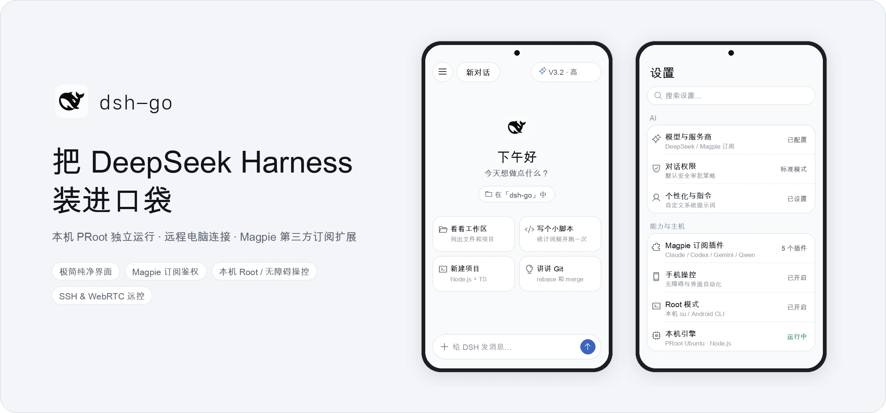

<p align="center">
  <b>简体中文</b> · <a href="README.en.md">English</a>
</p>

<p align="center">
  <picture>
    <source media="(prefers-color-scheme: dark)" srcset="docs/assets/hero-zh-dark.webp">
    
  </picture>
</p>

<p align="center">
  DeepSeek Harness 的 Android 移动端客户端，支持手机本机独立运行与远程主机连接。
</p>

<p align="center">
  <a href="https://github.com/oaeen/dsh-go/releases/latest"></a>
  <a href="LICENSE"></a>
</p>

## 项目简介

本项目 fork 自 [ccch1mneyyy/dsh-Go](https://github.com/ccch1mneyyy/dsh-Go)，是基于 [DeepSeek Harness](https://github.com/deepseek-ai/deepseek-harness) 的 Android 客户端。通过 Flutter 原生界面与内置的 Linux 运行时，在手机上直接运行或连接远程主机上的 DSH 引擎：

- **本机独立运行**：在应用内一键安装 Ubuntu、Node.js 与 DSH 运行环境（基于 PRoot），免 Root、免 Termux。
- **远程主机连接**：支持通过 SSH 隧道或 [DSHarness Remote](https://github.com/liguobao/ds-harness-remote)（WebRTC / 中继）连接电脑与服务器上的 DSH。
- **原生对话与工具交互**：支持模型切换、思考深度调节、中途插话与消息排队、图片与文件发送、语音输入、工具审批及网页模式切换。
- **手机操控与本地终端**：支持通过无障碍服务读取屏幕与执行点按输入，并提供显式的本机 Root 模式与 Android CLI 工具支持。
- **插件体系**：支持原生插件工具卡、配置表单、定时任务及官方 `ds-bot` 机器人适配。

## 本分支（Fork）的改动

本仓库主要面向**个人自用**，在上游项目的基础上进行了界面精简与能力扩展：

1. **界面与视觉样式优化**
   - 将浅色模式重构为干净的浅灰白背景（`#F8F9FA`）与纯白卡片（`#FFFFFF`），对齐现代原生 AI 客户端的简洁质感。
   - 替换应用图标与品牌标识为 DeepSeek Harness 官方鲸鱼标志。
   - 移除设置页、概览卡片及主页建议卡片中杂乱的彩色图标背景块，统一为干净的线性图标；移除状态项的圆点与胶囊底色，并隐藏顶栏和侧栏中冗余的本机空闲状态副标题。
2. **精简非必要功能**
   - 移除桌宠（Deepy / 鲸娘）相关入口与展示、首页底部轮播提示及上游推广内容，减少视觉与交互干扰。
3. **基于 Magpie 增加第三方订阅接口**
   - 集成 [Magpie](https://github.com/Bool-io/magpie) 订阅插件市场与引擎兼容层，打通 OAuth / Device Code / Web 登录态鉴权、凭据引用注册与长流帧头（`FRAME_OVERHEAD`）适配。
   - 支持直接接入 Claude Subscription、OpenAI Codex、Gemini CLI、Qwen Code、GitHub Copilot 等第三方订阅服务商模型。
4. **移动端操控与插件增强**
   - 新增显式 Root 模式设置页、本机 `su` CLI 与回环 `adbd` 引导支持，并完成官方 `ds-bot` 插件的移动端适配。

## 从源码构建

构建环境支持 Linux x86_64 与 macOS（需准备 JDK 17、Flutter `3.47.x`、Android SDK/NDK、Python 3 与 Node.js）：

```bash
git clone https://github.com/oaeen/dsh-go.git
cd dsh-go

# 准备工具链与运行环境包（首次构建运行时需在 Linux 环境或已有产物下执行）
bash tooling/setup-toolchain.sh
source tooling/env.sh
bash runtime/build-runtime.sh arm64-v8a

# 构建 arm64 Release APK
DSH_BETA_TOKEN_FILE= bash tooling/build-apk.sh -f arm64 --keep-daemon
```

构建产物位于 `app/build/app/outputs/flutter-apk/app-arm64-release.apk`。日常开发校验命令详见 [CONTRIBUTING.md](CONTRIBUTING.md)。

## 仓库目录

| 路径 | 说明 |
| --- | --- |
| `app/` | Flutter 原生客户端界面、状态管理与 Android 平台实现 |
| `packages/dsh_client/` | DSH Web API 纯 Dart 客户端（HTTP/SSE、复用与会话接口） |
| `packages/dsh_remote/` | DSH Remote 远程传输客户端（WebRTC / LAN / TURN / 中继） |
| `runtime/` | PRoot Linux 运行时打包、DSH 引擎补丁（`runtime/patches/`）与 HTTP 桥接 |
| `sdk/plugin-kit/` | 插件开发工具包 |
| `docs/` | 架构说明、用户指南与维护契约文档 |
| `tooling/` | 工具链安装与 APK 构建脚本 |

## 致谢与许可证

- 感谢原作者 **[ccch1mneyyy](https://github.com/ccch1mneyyy)** 开发并开源了优秀的 [dsh-Go](https://github.com/ccch1mneyyy/dsh-Go) 项目。
- 感谢 [DeepSeek Harness](https://github.com/deepseek-ai/deepseek-harness)、[Magpie](https://github.com/Bool-io/magpie) 以及李国宝老师开发的 [ds-harness-remote](https://github.com/liguobao/ds-harness-remote)。

本项目代码遵循 [AGPL-3.0](LICENSE) 许可证开源，`sdk/` 与 `examples/` 采用 MIT 许可证。第三方组件与素材版权及许可声明见 [THIRD_PARTY_NOTICES.md](THIRD_PARTY_NOTICES.md)。

<sub>本项目为非官方社区分支，与 DeepSeek 官方无关联。</sub>
